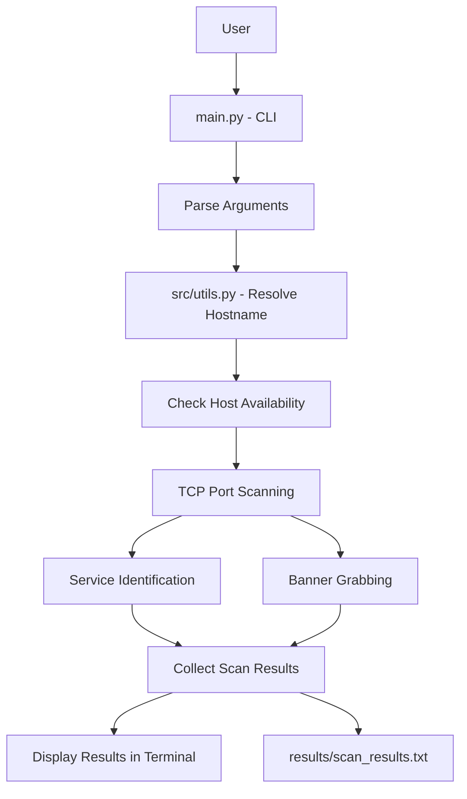

# Network Scanner


A Python-based network reconnaissance tool for host discovery, TCP port scanning, service identification, and basic banner grabbing.

Built as a cybersecurity portfolio project to practise Python networking, socket programming, error handling, and unit testing.

## Features

- **Host discovery:** Checks whether a target host is reachable.
- **TCP port scanning:** Scans a configurable range of TCP ports.
- **Service identification:** Attempts to identify common services by port number.
- **Banner grabbing:** Collects basic service responses where supported.
- **Hostname resolution:** Resolves hostnames to IP addresses.
- **Input validation:** Validates port ranges and target input.
- **Scan reports:** Saves scan findings to a text report.
- **Unit tests:** Tests core scanning and hostname-resolution functionality.


## Project Architecture

The Network Scanner follows a modular design that separates command-line handling, hostname resolution, TCP scanning, service identification, and result reporting.




## Project Structure

```text
network-scanner/
├── src/
│   ├── __init__.py
│   ├── scanner.py
│   └── utils.py
├── tests/
│   ├── __init__.py
│   ├── test_scanner.py
│   └── test_utils.py
├── results/
│   └── scan_results.txt
├── main.py
├── requirements.txt
├── .gitignore
├── LICENSE
└── README.md
```

## Requirements

- Python 3.10 or newer recommended
- Git
- Windows, Linux, or macOS

The scanner uses Python's standard networking libraries. Check `requirements.txt` for any additional dependencies.

## Installation

Clone the repository:

```bash
git clone https://github.com/Joyatosh-sinha/network-scanner.git
cd network-scanner
```

Run the scanner:

```bash
python main.py --target 127.0.0.1 --start 1 --end 100
```

Replace `127.0.0.1` with a hostname or IP address you are authorized to test.

## Usage

Specify the target and port range:

```bash
python main.py --target 127.0.0.1 --start 1 --end 100
```

Arguments:

| Argument | Description |
|---|---|
| `--target` | Target hostname or IP address (required) |
| `--start` | Starting TCP port; defaults to 1 |
| `--end` | Ending TCP port; defaults to 100 |

## Testing

Run the unit tests from the project root:

```bash
python -m unittest discover -s tests -v
```

The tests cover port-scanning behavior, service identification, and hostname resolution.

## Scan Reports

Scan reports are saved under `results/`. Review the report before sharing it publicly, and avoid publishing sensitive hostnames, internal IP information, or other private details.

## Learning Objectives

This project demonstrates practical experience with:

- Python socket programming
- TCP networking fundamentals
- Hostname and IP address resolution
- Basic service fingerprinting
- Exception handling and input validation
- Unit testing with `unittest`
- Git and GitHub project management

## Ethical Use

Use this tool only on systems you own or have explicit permission to assess. Only scan networks and hosts within your authorized scope.

This project is intended for educational purposes and authorized security testing.

## Demo


The following screenshot shows a local test run of the Network Scanner.


### Example command

```bash
python main.py --target 127.0.0.1 --start 7999 --end 8001
```

This example uses a local test environment. Results depend on which services are running and the network configuration.

### Automated tests

Run the unit tests with:

```bash
python -m unittest discover -s tests -v
```

## Author

**Joyatosh Sinha**

- GitHub: https://github.com/Joyatosh-sinha

