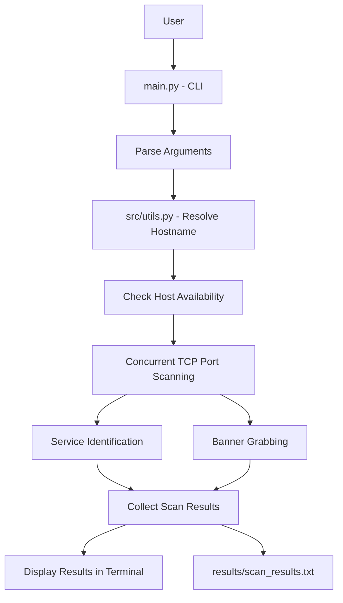
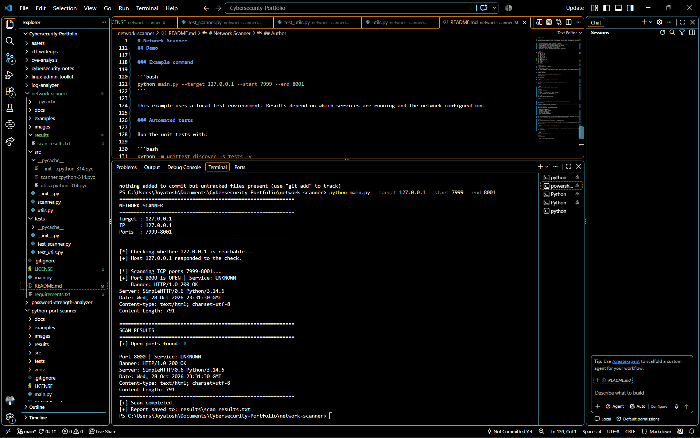

# Network Scanner

[](https://github.com/Joyatosh-sinha/network-scanner/actions/workflows/tests.yml)

A Python-based network reconnaissance tool for host discovery, TCP port scanning, service identification, and basic banner grabbing.

Built as a cybersecurity portfolio project to demonstrate practical knowledge of Python networking, socket programming, concurrent execution, input validation, error handling, and automated testing.

## Features

- **Host Discovery:** Checks whether a target host responds to ping requests.
- **TCP Port Scanning:** Scans a configurable range of TCP ports.
- **Concurrent Scanning:** Uses multiple worker threads to improve scanning performance.
- **Service Identification:** Identifies common network services using port numbers and basic banner analysis.
- **Banner Grabbing:** Collects basic service responses from supported ports.
- **Hostname Resolution:** Resolves hostnames into IP addresses.
- **Input Validation:** Validates target addresses, port ranges, and worker settings.
- **Scan Reports:** Saves scan findings to a text report.
- **Performance Benchmarking:** Compares sequential and concurrent scanning execution times.
- **Unit Testing:** Includes automated tests for core scanning and hostname-resolution functionality.

## Project Architecture

The Network Scanner follows a modular architecture that separates command-line handling, hostname resolution, host availability checks, TCP scanning, service identification, and result reporting.



## Project Structure

```text
network-scanner/
├── .github/
│   └── workflows/
│       └── tests.yml
├── docs/
│   └── images/
│       └── network-scanner-demo.png
├── src/
│   ├── __init__.py
│   ├── scanner.py
│   └── utils.py
├── tests/
│   ├── __init__.py
│   ├── test_scanner.py
│   └── test_utils.py
├── results/
│   └── scan_results.txt
├── benchmark.py
├── main.py
├── requirements.txt
├── .gitignore
├── LICENSE
└── README.md
```

## Requirements

- Python 3.10 or newer recommended
- Git
- Windows, Linux, or macOS

The scanner uses Python's standard networking libraries along with the additional packages listed in `requirements.txt`.

## Installation

### 1. Clone the repository

```bash
git clone https://github.com/Joyatosh-sinha/network-scanner.git
```

### 2. Navigate to the project directory

```bash
cd network-scanner
```

### 3. Install dependencies

```bash
python -m pip install -r requirements.txt
```

### 4. Run the scanner

```bash
python main.py --target 127.0.0.1 --start 1 --end 100
```

Replace `127.0.0.1` with a hostname or IP address you own or are explicitly authorized to test.

## Usage

### Basic scan

Specify a target and a port range:

```bash
python main.py --target 127.0.0.1 --start 1 --end 100
```

### Concurrent scan

Specify the number of worker threads:

```bash
python main.py --target 127.0.0.1 --start 1 --end 100 --workers 50
```

### Command-line arguments

| Argument | Description | Default |
|---|---|---|
| `--target` | Target hostname or IP address | Required |
| `--start` | Starting TCP port | 1 |
| `--end` | Ending TCP port | 100 |
| `--workers` | Maximum number of concurrent worker threads | 100 |

The scanner validates the target, port range, and worker configuration before scanning.

**Note:** Host discovery uses ping. Some systems and networks block ICMP requests, so a host may be reachable even if the ping check does not receive a response.

## Testing

Run the automated unit tests from the project root:

```bash
python -m unittest discover -s tests -v
```

Run code-quality checks with Ruff:

```bash
python -m ruff check .
```

The test suite covers:

- TCP port-scanning behavior
- Open and closed port handling
- Concurrent scanning
- Service identification
- Banner-based service detection
- Invalid input handling
- Hostname resolution

## Demo



The screenshot above shows the scanner running against a local test environment.

### Example command

```bash
python main.py --target 127.0.0.1 --start 7999 --end 8001 --workers 50
```

This example can be tested using a local HTTP server:

```bash
python -m http.server 8000
```

The scanner should detect port `8000` as open while the local HTTP server is running.

Results depend on the services running and the local network configuration.

## Scan Reports

Scan findings are saved in:

```text
results/scan_results.txt
```

The report contains information about the scan and detected open ports.

Review reports before sharing them publicly. Avoid publishing sensitive hostnames, internal IP addresses, or other private network information.

## Performance Benchmark

The project includes `benchmark.py` to compare sequential and concurrent TCP port scanning.

### Benchmark 1: 100 Ports

| Scanning Method | Execution Time |
|---|---:|
| Sequential | 100.8710 seconds |
| Concurrent (50 workers) | 2.0496 seconds |

**Measured speedup: 49.21x**

### Benchmark 2: Local HTTP Server

Target: `127.0.0.1`

Port range: `7999-8001`

| Scanning Method | Execution Time | Open Ports |
|---|---:|---|
| Sequential | 2.0188 seconds | 8000 |
| Concurrent (50 workers) | 1.0175 seconds | 8000 |

**Measured speedup: 1.98x**

Both scanning methods returned matching results in these benchmark runs.

**Benchmark note:** These are individual test runs, not averaged measurements. Performance depends on network conditions, connection timeouts, worker count, system resources, and the scanned port range. Results should not be interpreted as guaranteed performance improvements.

## Learning Objectives

This project demonstrates practical experience with:

- Python socket programming
- TCP networking fundamentals
- Hostname and IP address resolution
- Basic service fingerprinting
- Concurrent programming with `ThreadPoolExecutor`
- Exception handling and input validation
- Unit testing with Python's `unittest`
- Code quality checks with Ruff
- Git and GitHub project management
- Continuous integration with GitHub Actions

## Limitations

- The scanner currently focuses on TCP port scanning.
- Service identification is based on common port numbers and basic banner signatures.
- Banner grabbing is limited to supported services and may not always return useful information.
- Host discovery depends on ping responses.
- This tool does not perform vulnerability detection or exploitation.

## Ethical Use

Use this tool only on systems you own or have explicit permission to assess.

Only scan networks and hosts within your authorized scope. Unauthorized scanning may violate applicable laws, organizational policies, or network terms of service.

This project is intended for educational purposes and authorized security testing.

## Author

**Joyatosh Sinha**

- GitHub: [Joyatosh-sinha](https://github.com/Joyatosh-sinha)
- LinkedIn: [Joyatosh Sinha](https://www.linkedin.com/in/joyatosh-sinha-9a712824a/)
